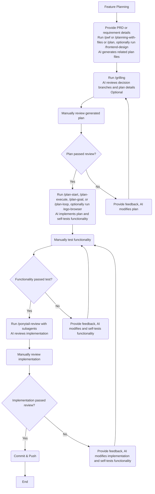
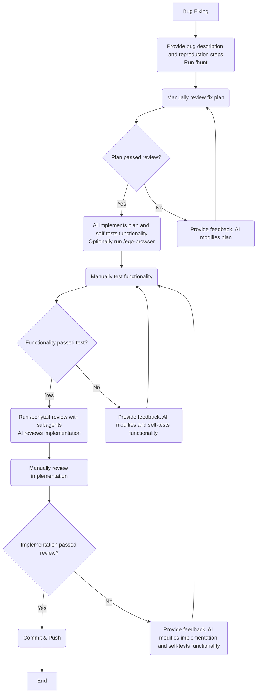
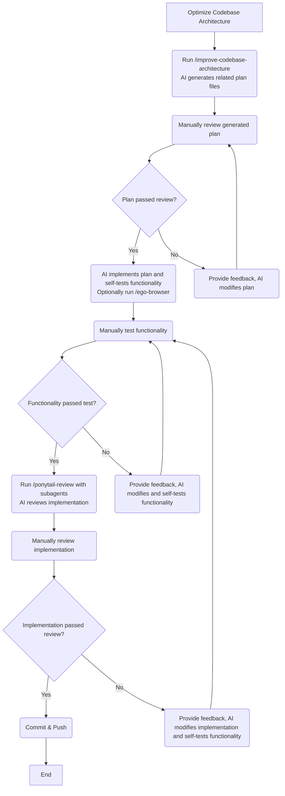

# AI

English | [简体中文](./README.zh-CN.md)

> This doc is translated by [Gemini](https://gemini.google.com/).

> Last updated on 2026-10-14. Please note that information may become outdated.

> If you are a beginner, this repository is likely not suitable for you. It is recommended to start your AI journey with [Cherry Studio](https://docs.cherry-ai.com/), [DeepSeek Chat](https://chat.deepseek.com/), and [Yuanbao](https://yuanbao.tencent.com/).

Personal global rules for AI Coding Agents.

## Background

In my daily work, I use Cursor, Claude Code, and Codex simultaneously (with Claude Code as my primary tool), mainly developing TypeScript and React applications. For open-source projects, I primarily use Pi to build libraries within ecosystems like TypeScript, React, Vue, and Node. Because their underlying designs differ, their performance varies as well. I created this repository in an effort to unify my experience across different Coding Agents and models.

Your actual situation is likely different from mine. For instance, [egolite](https://lite.ego.app/), which I use, currently only supports macOS. Therefore, I strongly recommend that you fork this repository and customize it for yourself.

## Models

In terms of code quality and cost-effectiveness, Opus and GPT are the best choices among overseas models, followed by Grok. Among domestic (Chinese) models, GLM + DeepSeek is the best combination.

> **NEVER try to save money on models! The most expensive cost in programming is rework time, and non-top-tier models waste far, far more time than top-tier models do!**
> For users in China, the easiest way to access Opus and GPT is through API relays (API proxies). Relays must not downgrade model quality ("water down" responses) or maliciously block requests, otherwise, the user experience will be severely impacted. Personally, I recommend [aicentos](https://aicentos.com/sign-up?aff=mgM8), [AiGoCode](https://aigocode.com/invite/7XH6NZZZ), and [CCSub](https://www.ccsub.net/register?ref=TUM8D23V).

## Tools

When it comes to overseas tools: [Claude Code](https://claude.com/product/claude-code) > [Codex](https://chatgpt.com/codex/) > [Pi](https://pi.dev/) ≈ [Omp](https://omp.sh/) > [Cursor](https://cursor.com/) >> [OpenCode](https://opencode.ai/)

Claude Code has the best engineering implementation. It runs smoothly and allows easy integration with models from various providers.

The latest version of Codex restricts integration exclusively to the Responses API, but model support is low and limitations are significant. If you really want to connect other models, you can use [magpie](https://usemagpie.ai/), [CC Switch](https://ccswitch.io/), or [opencodex](https://github.com/lidge-jun/opencodex).

> 👍 If you are able to, please sponsor and support these excellent open-source projects!

Pi places greater emphasis on custom assembly. Its engineering implementation is outstanding, and it supports a wide range of models. Omp is pre-assembled on top of Pi while preserving Pi's advantages. If you enjoy tweaking and configuring things, try Pi; if you prefer an out-of-the-box solution, you can use Omp directly.

Cursor only offers pay-as-you-go pricing, and its engineering implementation is not as refined as Claude Code or Codex. Currently, it heavily pushes its in-house Composer and Grok models, requiring paid subscriptions just to connect third-party APIs. It feels somewhat clumsy at present.

OpenCode is fully open source, but its engineering quality is relatively poor, lacking polish in many subtle UX details. Its only merit is being open source and controllable. It is recommended to avoid using it or purchasing OpenCode products, as there are suspicions of quantization and context truncation 😅.

> Grok-related performance has not been specifically tested yet.

Domestic tools are more complex, as model providers often offer their own official tools that can be used directly, such as:

- Kimi provides the [Kimi Series](https://www.kimi.com/products/download)
- GLM provides [ZCode](https://zcode.z.ai/)
- Qwen provides the [Qoder Series](https://qoder.com.cn/)
- Seed provides the [Trae Series](https://www.trae.cn/)
- HY provides the [Buddy Series](https://www.codebuddy.cn/)
- Mimo provides [mimo-code](https://mimo.xiaomi.com/zh/mimocode) and [mimo-desktop](https://mimo.xiaomimimo.com/desktop/)

DeepSeek is a special case: I feel that their official tool, DeepSeek Harness, still lacks polish. I recommend using Pi, Omp, or [Reasonix](https://reasonix.io/) instead.

## My Personal Evaluation

For evaluating model capabilities and intelligence levels, it is recommended to refer to [Artificial Analysis](https://artificialanalysis.ai/). However, actual performance still depends on factors like model degradation/dumbing-down and tool compatibility. Below are my personal evaluations based on tool + model combinations for reference only.

1. 👍 Claude Code + Official Subscription / Relay
- Medium speed.
- Recommended setup: Opus 5.5 as the main model, Sonnet 5.5 as the sub-agent model, with the main model's Effort Level set to `high`. It occasionally overthinks or experiences slight intelligence degradation, but it is suitable for daily use. For complex tasks, Effort Level can be set to `xhigh` or `max`.
- Suitable for complex work such as planning, architectural design, and coding tasks. It rarely over-engineers and never engages in defensive programming.
- Opus 5.5 + Sonnet 5.5 is currently the best model combination.


2. 👍 Codex + Official Subscription / Relay
- Medium speed.
- Recommended setup: GPT 6.1 Sol as both the main and sub-agent model, with Effort Level set to `high`. It occasionally overthinks or experiences slight intelligence degradation, but is suitable for daily use. For particularly complex tasks, Effort Level can be set to `xhigh` or `max`.
- Suitable for reviewing plans, architecture, and code implementations. It frequently over-engineers and writes defensive code, but this behavior can be reduced using prompts.
- One of the best models available.


3. 👍 Pi
- Speed mainly depends on the model provider.
- Model integration is fully customizable, but setting default main and sub-agent models is still recommended.
- Personally, I use Opus 5.5 high as the default main model and Sonnet 5.5 high as the default sub-agent model. I also recommend the cost-effective combination of GPT 6.1 Sol high / Grok 4.7 xhigh + DeepSeek 4.1 Flash high.


4. 👎︎ Cursor + Composer 2.5 / Grok 4.7
- Very fast.
- Does not overthink, but occasionally under-thinks.
- Composer 2.5 is suitable for quick Q&A, locating code, verifying execution paths, and making minor edits. Grok 4.7 is suitable for complex tasks.
- Expresses normally in both English and Chinese, though it occasionally answers in Chinese when prompted in English (does not affect normal usage).
- Mindset shift: If you prefer using an editor/IDE over CLI tools or desktop apps, Cursor is your best option. You should view Cursor as a $20 gateway to top-tier models + a tool providing massive quota usage for Composer 2.5 / Grok 4.7.
- Still not as good as using VS Code directly with a Claude Code / Codex subscription, or purchasing a Grok plan directly.


5. 👎︎ ZCode + GLM 5.3 / GLM 5.3 Flash
- Medium speed.
- Recommended setup: GLM 5.3 as the main model and GLM 5.3 Flash as the sub-agent model, with Effort Level set to `max`.
- GLM 5.3 Max is suitable for complex tasks like making plans and determining architecture. It occasionally over-engineers and writes defensive code, and often overthinks, under-thinks, or second-guesses itself, but ultimately delivers results.
- GLM 5.3 Flash Max is better suited for daily usage.
- One of the best coding models in China, but its operations and service management are extremely poor; you're better off using DeepSeek directly.


## Global Rules Configuration

[AGENTS.md](https://agents.md/) is a universal guide for Coding Agents that can be used for global rules configuration.

This repository provides the [AGENTS.md](https://www.google.com/search?q=./AGENTS.md) I use personally, along with the shell script used for synchronization. **Note: You need to install [bun](https://bun.com/) and the latest version of [Node.js LTS](https://nodejs.org/).**

```shell
/bin/bash -c "$(curl -fsSL https://raw.githubusercontent.com/ModyQyW/ai/refs/heads/main/bump-global-agents-md.sh)"

```

## Global Packages and Skills Setup

This repository provides the shell script used for my global package tools and Skills.

**Note: You need to install [bun](https://bun.com/) and use the latest version of [Node.js LTS](https://nodejs.org/).**

```shell
/bin/bash -c "$(curl -fsSL https://raw.githubusercontent.com/ModyQyW/ai/refs/heads/main/bump-global-packages-and-skills.sh)"

```

**Note: After running the above command, you still need to manually install [ponytail](https://github.com/DietrichGebert/ponytail) and [planning-with-files](https://github.com/OthmanAdi/planning-with-files); otherwise, certain commands will not work.**

## Common Workflows

### Feature Planning



### Bug Fixing



### Optimizing Codebase Architecture



### Handling Merges

```text
Merge main into feat-xxx. Resolve the conflicts properly. Commit & push.

```

```text
Squash merge feat-xxx into main.

```

## FAQ

### I am using multiple GitHub accounts. Is there an automatic switching solution?

Please refer to [Ability to set a default GH CLI user in a repository](https://github.com/cli/cli/discussions/12237).

### I don't like pieced-together workflows. Are there complete end-to-end alternatives?

If you prefer a complete, all-in-one workflow suit rather than a pieced-together one, check out:

- [addyosmani/agent-skills](https://github.com/addyosmani/agent-skills)
- [cursor/plugins pstack](https://github.com/cursor/plugins/tree/main/pstack)
- [mattpocock/skills](https://github.com/mattpocock/skills)
- [tw93/Waza](https://github.com/tw93/Waza)

## Acknowledgments

- [addyosmani/agent-skills](https://github.com/addyosmani/agent-skills)
- [AGENTS.md](https://agents.md/)
- [cursor/plugins pstack](https://github.com/cursor/plugins/tree/main/pstack)
- [mattpocock/skills](https://github.com/mattpocock/skills)
- [multica-ai/andrej-karpathy-skills](https://github.com/multica-ai/andrej-karpathy-skills)
- [tw93/Waza](https://github.com/tw93/Waza)
