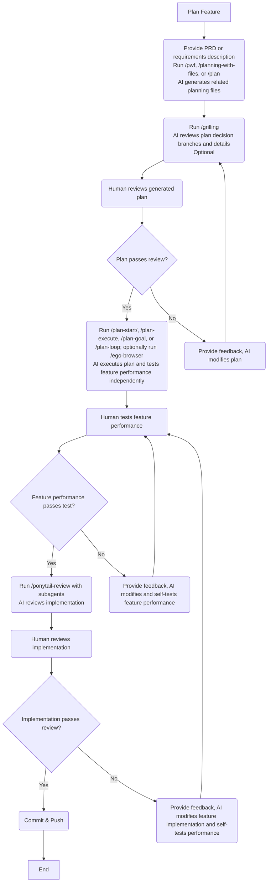
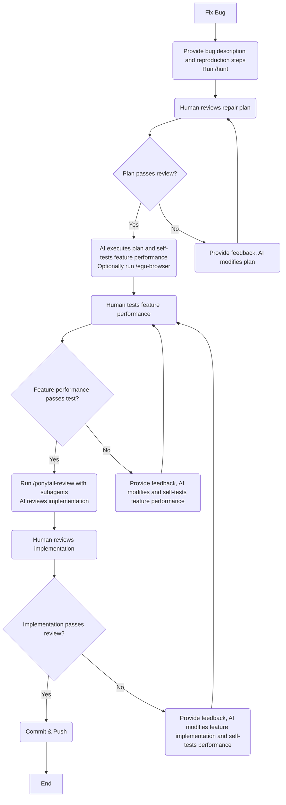
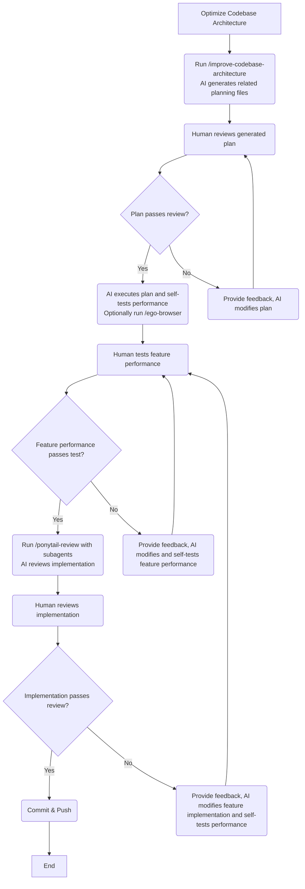

# AI

English | [简体中文](./README.zh-CN.md)

> This doc is translated by [Gemini](https://gemini.google.com/).

> Last updated on Oct 12, 2026. Please check if the information has expired.

> If you are a beginner, this repository is likely not suitable for you. We recommend starting your AI journey with [Cherry Studio](https://docs.cherry-ai.com/), [DeepSeek Chat](https://chat.deepseek.com/), and [Yuanbao](https://yuanbao.tencent.com/).

Global rules for my personal AI Coding Agent setup.

## Background

In my daily workflow, I use Cursor, Claude Code, and Codex concurrently, primarily developing TypeScript and React applications. For open-source projects, I mainly use Pi, developing libraries related to the TypeScript, React, Vue, and Node ecosystems. Their underlying designs and behaviors vary, and I wanted to unify my experience across different Coding Agents and models—hence this repository.

Your actual setup will likely differ from mine; for example, [egolite](https://lite.ego.app/) currently only supports macOS. Therefore, I strongly recommend forking this repository and customizing it to suit your needs.

## Models

In terms of code quality and cost-effectiveness, Opus and GPT are the best choices among overseas models, followed by Grok. Among domestic (Chinese) models, GLM + DeepSeek are the best choices.

> **Never try to save money on models! The most expensive cost in programming is almost always rework time. The time wasted by inferior models is vastly—vastly—more than the cost of top-tier models!**
>
> The easiest way to access Opus and GPT in China is through API transit/proxy providers. These providers must not dilute services or maliciously intercept traffic, as this severely impacts usability. Personally, I recommend [aicentos](https://aicentos.com/sign-up?aff=mgM8), [AiGoCode](https://aigocode.com/invite/7XH6NZZZ), and [CCSub](https://www.ccsub.net/register?ref=TUM8D23V).

## Tools

For overseas tools: [Claude Code](https://claude.com/product/claude-code) > [Codex](https://chatgpt.com/codex/) > [Pi](https://pi.dev/) ≈ [Omp](https://omp.sh/) > [Cursor](https://cursor.com/) >> [OpenCode](https://opencode.ai/)

Claude Code has the best engineering, offers a smooth user experience, and makes integrating various models straightforward.

The latest version of Codex restricts integration to the Responses API, offering lower model support and tighter limitations. If you really want to connect it, you can use [magpie](https://usemagpie.ai/), [CC Switch](https://ccswitch.io/), or [opencodex](https://github.com/lidge-jun/opencodex).

> 👍 If you are able to, please sponsor and support these fantastic open-source projects!

Pi emphasizes free assembly, features exceptional engineering, and supports a broad range of models. Omp builds upon Pi with pre-configured assembly while retaining Pi's advantages. If you enjoy tweaking and configuring things, give Pi a try; if you prefer out-of-the-box convenience, you can use Omp directly.

Cursor only offers pay-as-you-go pricing, and its engineering is not as polished as Claude Code or Codex. It currently heavily pushes its own Composer and Grok models, requiring an upfront payment just to use third-party integrations, which feels somewhat clunky nowadays.

OpenCode is purely open source, but its engineering is relatively poor, with many user experience details lacking polish. Its only advantage is being open-source and controllable. It is recommended not to use it, nor to purchase products from OpenCode, as they suspecting engage in quantization and context truncation 😅

> Grok-related tools have not been specifically tested.

Domestic (Chinese) tools are more complex. Model providers often supply official tools that you can use directly, such as:

- Kimi provides the [Kimi Series](https://www.kimi.com/products/download)
- GLM provides [ZCode](https://zcode.z.ai/)
- Qwen provides the [Qoder Series](https://qoder.com.cn/)
- Seed provides the [Trae Series](https://www.trae.cn/)
- HY provides the [Buddy Series](https://www.codebuddy.cn/)
- Mimo provides [mimo-code](https://mimo.xiaomi.com/zh/mimocode) and [mimo-desktop](https://mimo.xiaomimimo.com/desktop/)

DeepSeek is an exception. In my view, the official DeepSeek Harness tool still lacks polish; it is recommended to use Pi, Omp, or [Reasonix](https://reasonix.io/) instead.

## My Personal Evaluation

For evaluating model capabilities and intelligence levels, it is recommended to consult [Artificial Analysis](https://artificialanalysis.ai/). However, actual performance still depends on whether the model experiences degradation (lobotomization) and whether the tool matches properly. The following personal evaluations are based on Tool + Model combinations and are for reference only.

1. 👍 Claude Code + Official Subscription / Proxy
   - Medium speed
   - Recommended setup: Use Opus 5.5 as the main model and Sonnet 5.5 as the sub-agent model. Set the main model's Effort Level to `high`. Occasionally over-thinks or under-performs slightly, but suitable for daily use. For complex work, it can be set to `xhigh` or `max`.
   - Ideal for complex tasks like planning, architecture design, and coding tasks. Barely over-engineers and completely avoids defensive programming.
   - Opus 5.5 + Sonnet 5.5 is currently the best model combination.
2. 👍 Codex + Official Subscription / Proxy
   - Medium speed
   - Recommended setup: Use GPT 6.1 Sol as both the main model and sub-agent model. Set the Effort Level to `high`. Occasionally over-thinks or under-performs slightly, but suitable for daily use. For particularly complex work, it can be set to `xhigh` or `max`.
   - Ideal for reviewing plans, architecture, and code implementations. Frequently over-engineers and practices defensive programming; you can use prompts to mitigate these behaviors.
   - One of the best models.
3. 👍 Pi
   - Speed primarily depends on the model provider.
   - Model integration is completely up to you, though setting default main and sub-agent models is still recommended.
4. 👎︎ Cursor + Composer 2.5 Thinking / Grok 4.7 Thinking
   - Very fast speed
   - Does not over-think, occasionally under-thinks.
   - Composer 2.5 is suitable for quick Q&A, locating code, tracing code execution paths, and minor edits; Grok 4.7 is suited for complex tasks.
   - Chinese and English expression are normal, though it occasionally answers in Chinese to English prompts, which does not affect regular usage.
   - Mindset shift: If you are more accustomed to using an editor / IDE rather than other CLI / Desktop APPs, Cursor is your optimal choice. You need to view Cursor as a top-tier model connector for $20 + massive allowances for Composer 2.5 / Grok 4.7 tool usage.
   - Alternatively, you might as well just use VS Code + Claude Code / Codex subscription, or directly purchase a Grok package.
5. 👎︎ ZCode + GLM 5.3 / GLM 5.3 Flash
   - Medium speed
   - Recommended setup: Use GLM 5.3 as the main model and GLM 5.3 Flash as the sub-agent model. Set the Effort Level to `max`.
   - GLM 5.3 Max is suitable for complex tasks like planning and architecture determination. Occasionally over-engineers and practices defensive programming, frequently over- or under-thinks, and engages in left-brain vs. right-brain internal struggles, but ultimately delivers results.
   - GLM 5.3 Flash Max is better suited for daily use.
   - One of the best domestic programming models, but operationally and support-wise extremely poor. You're better off just using DeepSeek directly.

## Global Rules Setup

[AGENTS.md](https://agents.md/) is a universal Coding Agents guide that can be used for global rules configuration.

This repository provides the [AGENTS.md](./AGENTS.md) I use personally, along with the shell script used to sync it. **Note: You need to have [bun](https://bun.com/) and the latest version of [Node.js LTS](https://nodejs.org/) installed.**

```shell
/bin/bash -c "$(curl -fsSL https://raw.githubusercontent.com/ModyQyW/ai/refs/heads/main/bump-global-agents-md.sh)"
```

## Global Packages and Skills Setup

This repository provides the shell script for setting up my personal global package tools and Skills.

**Note: You need to have [bun](https://bun.com/) and the latest version of [Node.js LTS](https://nodejs.org/) installed.**

```shell
/bin/bash -c "$(curl -fsSL https://raw.githubusercontent.com/ModyQyW/ai/refs/heads/main/bump-global-packages-and-skills.sh)"
```

**Note: After executing the above command, you also need to manually install [ponytail](https://github.com/DietrichGebert/ponytail) and [planning-with-files](https://github.com/OthmanAdi/planning-with-files), otherwise some commands will not work.**

## Common Workflows

### Feature Planning



### Bug Fixing



### Codebase Architecture Refactoring



### Handling Merges

```text
Merge main into feat-xxx. Resolve the conflicts properly. Commit & push.
```

```text
Squash merge feat-xxx into main.
```

## Alternatives?

If you prefer a comprehensive workflow suite rather than a piecemeal setup like mine, check out [mattpocock/skills](https://github.com/mattpocock/skills) and [tw93/Waza](https://github.com/tw93/Waza).

## Acknowledgments

- [AGENTS.md](https://agents.md/)
- [mattpocock/skills](https://github.com/mattpocock/skills)
- [multica-ai/andrej-karpathy-skills](https://github.com/multica-ai/andrej-karpathy-skills)
- [tw93/Waza](https://github.com/tw93/Waza)