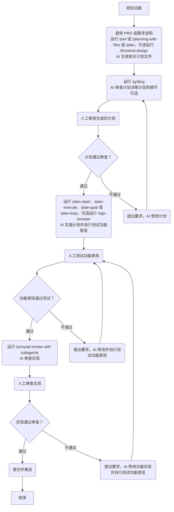
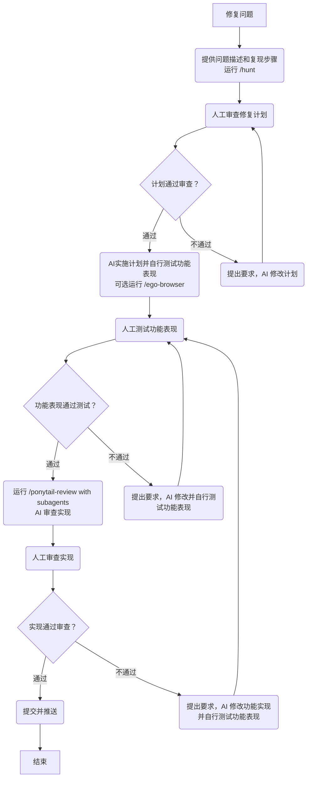
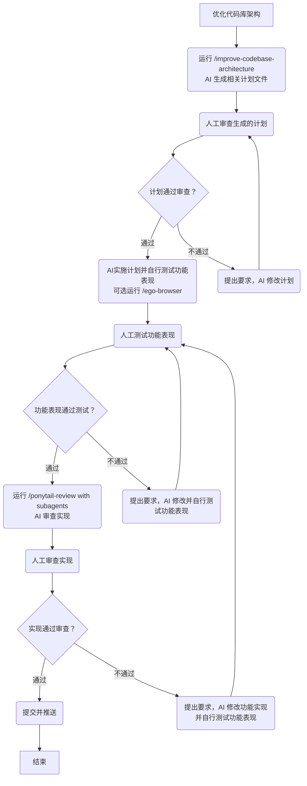

# AI

[English](./README.md) | 简体中文

> 最后更新于 2026-10-14，请留意信息是否过期。

> 如果你是一个新手，本仓库大概率不适合你。推荐先从 [Cherry Studio](https://docs.cherry-ai.com/)、[DeepSeek Chat](https://chat.deepseek.com/) 和 [元宝](https://yuanbao.tencent.com/) 开始你的 AI 之旅。

自用的 AI Coding Agent 全局规则。

## 背景

在日常工作中，我同时使用 Cursor、Claude Code 和 Codex（Claude Code 为主），主要开发 TypeScript 和 React 应用。在开源项目上，我主要使用 Pi，开发 TypeScript、React、Vue、Node 等相关生态的库。它们的底层设计各异，表现也各不相同，我试图统一我在不同 Coding Agent、不同模型上的体验，因此有了该仓库。

你的实际情况很有可能和我不同，比如我使用的 [egolite](https://lite.ego.app/) 目前只支持 macOS，所以我非常建议你分叉该仓库并自行定制。

## 模型

根据代码质量和性价比这两方面来看，海外模型中 Opus 和 GPT 是最佳选择，Grok 次之。国内模型中 GLM + DeepSeek 是最佳选择。

> **绝对不要在模型上省钱！编程最贵的成本往往是返工时间，而非顶尖模型浪费的时间比顶尖模型多得多得多！**
>
> 国内用上 Opus 和 GPT 最简单的方案就是买中转站。中转站不能掺水，或者恶意拦截，否则极其影响使用。个人推荐 [aicentos](https://aicentos.com/sign-up?aff=mgM8)、[AiGoCode](https://aigocode.com/invite/7XH6NZZZ) 和 [CCSub](https://www.ccsub.net/register?ref=TUM8D23V)。

## 工具

海外工具方面，[Claude Code](https://claude.com/product/claude-code) > [Codex](https://chatgpt.com/codex/) > [Pi](https://pi.dev/) ≈ [Omp](https://omp.sh/) > [Cursor](https://cursor.com/) >> [OpenCode](https://opencode.ai/)

Claude Code 的工程化做得最好，使用流畅，各家模型接入也容易。

Codex 最新版限制了只能接入 Responses API，但模型支持度较低，限制较大。实在想接入可以用 [magpie](https://usemagpie.ai/)、 [CC Switch](https://ccswitch.io/) 或 [opencodex](https://github.com/lidge-jun/opencodex) 接入。

> 👍 如果有条件，请赞助支持这些优秀的开源项目！

Pi 更强调自由组装，工程化非常优秀，适配模型广。Omp 在 Pi 基础上做好了组装，保留了 Pi 的优点。能接受折腾的话可以试试折腾 Pi，不想折腾的话可以直接用 Omp。

Cursor 只有按量计费，工程化做得不如 Claude Code 和 Codex。现在强推自家的 Composer 和 Grok 模型，要接入第三方还要先付费。在当下显得有些笨拙。

OpenCode 纯开源，工程化比较差，很多体验细节打磨不足，只胜在开源可控。建议别用，也别买 OpenCode 家的产品，疑似存在量化和上下文裁剪😅

> Grok 相关未具体测试。

国内工具方面更为复杂，模型提供方往往提供了官方工具，直接使用即可，比如

- Kimi 提供了 [Kimi 系列](https://www.kimi.com/products/download)
- GLM 提供了 [ZCode](https://zcode.z.ai/)
- Qwen 提供了 [Qoder 系列](https://qoder.com.cn/)
- Seed 提供了 [Trae 系列](https://www.trae.cn/)
- HY 提供了 [Buddy 系列](https://www.codebuddy.cn/)
- Mimo 提供了 [mimo-code](https://mimo.xiaomi.com/zh/mimocode) 和 [mimo-desktop](https://mimo.xiaomimimo.com/desktop/)

比较特别的是 DeepSeek，我认为官方工具 DeepSeek Harness 打磨度仍然不足，建议使用 Pi、Omp 或 [Reasonix](https://reasonix.io/)。

## 我的个人评价

模型能力和智能程度评估，建议参考 [Artificial Analysis](https://artificialanalysis.ai/)，但具体表现仍然取决于模型本身有无降智、工具是否匹配等。以下基于工具 + 模型给出我个人评价，仅供参考。

1. 👍 Claude Code + 官方订阅 / 中转
   - 速度中等
   - 推荐将 Opus 5.5 作为主模型、Sonnet 5.5 作为子代理模型，主模型 Effort Level 设置为 high，偶尔思考过度，偶尔降智，可日常使用，复杂工作可以设置为 xhigh 或 max
   - 适合做制定计划、架构确定和编码任务等复杂工作，几乎不过度设计，完全不防御性编程
   - Opus 5.5 + Sonnet 5.5 是当前最佳模型搭配
2. 👍 Codex + 官方订阅 / 中转
   - 速度中等
   - 推荐将 GPT 6.1 Sol 作为主模型和子代理模型，Effort Level 设置为 high，偶尔思考过度，偶尔降智，可日常使用，特别复杂的工作可以设置为 xhigh 或 max
   - 适合 review 计划、架构、代码实现等，经常过度设计和防御性编程，可以用提示词削弱这类行为
   - 最佳模型之一
3. 👍 Pi
   - 速度主要取决于模型供应商
   - 模型接入随自己心意，但仍然推荐设置默认的主模型和子代理模型
   - 我个人使用 Opus 5.5 high 作为默认主模型、Sonnet 5.5 high 作为默认子代理模型，也推荐 GPT 6.1 Sol High / Grok 4.7 xhigh + DeepSeek 4.1 Flash high 的性价比组合
4. 👎︎ Cursor + Composer 2.5 / Grok 4.7
   - 速度很快
   - 思考不过度，偶尔思考不足
   - Composer 2.5 适合做快速问答、确认代码位置、确认代码链路、小修小改等简单工作，Grok 4.7 适合做复杂任务
   - 中英文表达正常，但偶尔会出现英文提问中文回答的情况，不影响正常使用
   - 转变心态：如果你更习惯使用编辑器 / IDE 而不是其它 CLI / Desktop APP，Cursor 是你的最优选择，你需要将 Cursor 视为 $20 的顶级模型接入器 + 超大额度 Composer 2.5 / Grok 4.7 使用工具
   - 不如直接 VS Code + Claude Code / Codex 订阅，又或者直接买 Grok 套餐
5. 👎︎ ZCode + GLM 5.3 / GLM 5.3 Flash
   - 速度中等
   - 推荐将 GLM 5.3 作为主模型，GLM 5.3 Flash 作为子代理模型，Effort Level 设置为 max
   - GLM 5.3 Max 适合做制定计划和架构确定等复杂任务，偶尔过度设计和防御性编程，经常思考过度或不足、左右脑互搏，但最后能交付成果
   - GLM 5.3 Flash Max 更适合日常使用
   - 国内最佳编程模型之一，但运营特别特别差，不如直接用 DeepSeek

## 全局规则设置

[AGENTS.md](https://agents.md/) 是通用的 Coding Agents 指南，可用于全局规则设置。

本仓库提供了我自己使用的 [AGENTS.md](./AGENTS.md) 以及同步所用的 shell 脚本。**注意，你需要安装 [bun](https://bun.com/) 和最新版本的 [Node.js LTS](https://nodejs.org/)。**

```shell
/bin/bash -c "$(curl -fsSL https://raw.githubusercontent.com/ModyQyW/ai/refs/heads/main/bump-global-agents-md.sh)"
```

## 全局包和 Skills 设置

本仓库提供了我自己使用的全局包工具和 Skills 所用的 shell 脚本。

**注意，你需要安装 [bun](https://bun.com/)，并使用最新版本的 [Node.js LTS](https://nodejs.org/)。**

```shell
/bin/bash -c "$(curl -fsSL https://raw.githubusercontent.com/ModyQyW/ai/refs/heads/main/bump-global-packages-and-skills.sh)"
```

**注意，执行以上命令后，你还需要手动安装 [ponytail](https://github.com/DietrichGebert/ponytail) 和 [planning-with-files](https://github.com/OthmanAdi/planning-with-files)，否则部分命令无法使用。**

## 常见工作流

### 规划功能



### 修复问题



### 优化代码库架构



### 处理合并

```text
Merge main into feat-xxx. Resolve the conflicts properly. Commit & push.
```

```text
Squash merge feat-xxx into main.
```

## FAQ

### 我正在使用多个 GitHub 账号，有自动切换的方案吗？

请参考 [Ability to set a default GH CLI user in a repository](https://github.com/cli/cli/discussions/12237)。

### 我不想使用 ponytail-review 审查代码，有其它选择吗？

- Claude Code 和 Codex 都提供了自带的 Code Review
- [mattpocock/skills](https://github.com/mattpocock/skills) 提供了 Code Review Skill
- [tw93/Waza](https://github.com/tw93/Waza) 提供了 Check Skill

### 我不喜欢拼凑的工作流，有其它整套的选择吗？

如果你希望使用一整套的工作流，而不是当前拼凑的工作流，推荐看看以下内容：

- [addyosmani/agent-skills](https://github.com/addyosmani/agent-skills)
- [cursor/plugins pstack](https://github.com/cursor/plugins/tree/main/pstack)
- [mattpocock/skills](https://github.com/mattpocock/skills)
- [tw93/Waza](https://github.com/tw93/Waza)

## 致谢

- [addyosmani/agent-skills](https://github.com/addyosmani/agent-skills)
- [AGENTS.md](https://agents.md/)
- [cursor/plugins pstack](https://github.com/cursor/plugins/tree/main/pstack)
- [mattpocock/skills](https://github.com/mattpocock/skills)
- [multica-ai/andrej-karpathy-skills](https://github.com/multica-ai/andrej-karpathy-skills)
- [tw93/Waza](https://github.com/tw93/Waza)
